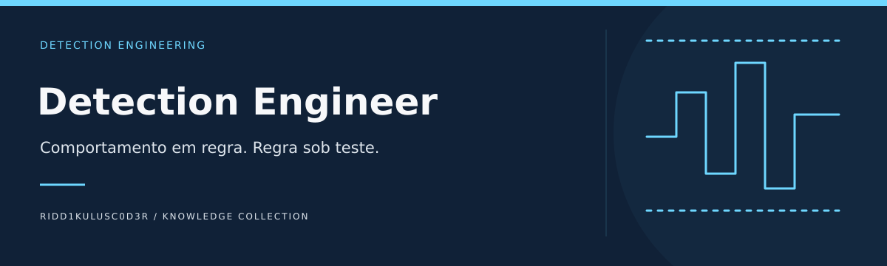

# Detection Engineer

**Comportamento em regra. Regra sob teste.**

Projetar o ciclo de vida de detecções: requisito de telemetria, lógica analítica, testes positivos e negativos, tuning, revisão e retirada.

[Comece aqui](docs/COMECE-AQUI.md) · [Referências comentadas](docs/REFERENCIAS.md) · [Identidade visual](docs/IDENTIDADE-VISUAL.md) · [Caso guiado](examples/caso-01.md) · [Modelo de trabalho](templates/ficha.md)

## Objetivo e fronteiras

ThreatHunting descobre e investiga; este repositório transforma comportamentos observáveis em especificações de detecção reproduzíveis.

## Caminhos de uso

| Etapa | Pergunta de trabalho | Entrega |
|---|---|---|
| Especificar | Definir comportamento e contrato de dados | Especificação analítica |
| Validar | Comparar sinais e controles negativos | Matriz de testes |
| Operar | Definir tuning, responsável e rollback | Ficha de implantação |

## Começar

1. Leia o [guia de entrada](docs/COMECE-AQUI.md).
2. Escolha uma [referência pelo problema](docs/REFERENCIAS.md), não pela popularidade.
3. Resolva o [caso sintético](examples/caso-01.md) e registre sua análise na [ficha](templates/ficha.md).

## Estado atual

Base documental inicial com objetivos, referências comentadas, modelo de trabalho e um exercício de mesa sintético. O caso é resolvido por leitura e análise; não há ambiente executável, integração ativa ou validação em produção nesta entrega.

## Contribuir

Inclua problema resolvido, fonte original, data, limitações e condições de reutilização. Diferencie observação, interpretação e hipótese. Recursos externos permanecem sujeitos às licenças e condições dos respectivos autores.

## Conexões no portfólio

[ThreatHunting](https://github.com/Ridd1kulusC0d3r/ThreatHunting) · [SOC](https://github.com/Ridd1kulusC0d3r/SOC) · [Cyber-Threat-Context-Modeling](https://github.com/Ridd1kulusC0d3r/Cyber-Threat-Context-Modeling)

As fronteiras acima definem a direção deste projeto; links relacionados não significam integrações implementadas.

[Contrato de dados e matriz de validação](docs/VALIDACAO.md)
